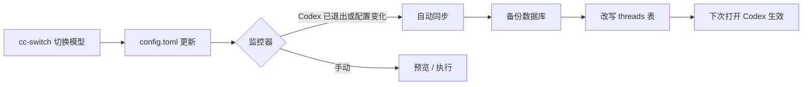

# Codex 模型同步器

> 一键解决 cc-switch 切换模型后，Codex 旧对话仍锁定创建时模型的问题。

[](LICENSE)
[](https://www.python.org/)
[]()

## 背景与痛点

Codex 桌面端在创建任务时会把它那一刻选择的 `model` / `model_provider` 写死在
`state_*.sqlite` 的 `threads` 表中，之后续聊一直沿用，不会随全局配置变化。

使用 [cc-switch](https://github.com/farion1231/cc-switch) 等工具切换供应商或模型时，
它只改写 `~/.codex/config.toml`，**不会更新已存在的旧任务**。结果就是：
新任务用新模型，旧对话永远停留在创建时的模型。

本工具正是为解决这一痛点而生：将 Codex 所有旧任务锁定的模型/供应商，
批量同步为当前全局配置的默认值，并提供预览、自动备份与后台监控能力。

## 功能特性

- ✅ **图形化界面**：无需命令行，双击即用
- ✅ **预览模式（只读）**：先看清会修改哪些任务，再决定是否执行
- ✅ **自动备份**：写库前自动备份数据库，支持一键打开备份目录、随时恢复
- ✅ **后台托盘运行**：关闭窗口后驻留系统托盘，继续静默监控
- ✅ **自动同步**：检测到 Codex 退出、或模型/供应商配置变化时自动执行
- ✅ **开机自启**：开机后自动进入监控模式
- ✅ **同步定时任务**：一并更新 `automation.toml` 中的模型配置
- ✅ **低占用**：进程检测基于系统 API 直接枚举，不反复启动子进程

## 快速开始

### 方式一：直接使用（推荐）

从 Releases 下载 `Codex模型同步器.exe`，双击运行即可，无需安装 Python。

> 提示：首次运行若出现 SmartScreen 提示，选择「更多信息 → 仍要运行」。
> 这是未签名程序的正常现象。

### 方式二：从源码运行

```bash
python -m pip install -r requirements.txt
python codex_model_sync_app.py
```

## 使用说明

### 界面操作

| 功能 | 说明 |
| ---- | ---- |
| 预览修改 | 只读检查哪些旧任务将被修改，不写入任何文件 |
| 执行同步 | 将旧任务批量改为目标模型/供应商（写库前自动备份） |
| 打开备份目录 | 一键打开最近的备份文件夹 |
| 自动同步 | 开启后每约 2 秒检测一次；Codex 退出或配置变化时自动同步 |
| 开机自启 | 勾选后开机自动进入监控模式 |

### 系统托盘

点击窗口关闭按钮不会退出，而是最小化到系统托盘继续运行。右键托盘图标：

- **显示主界面**：恢复窗口
- **立即同步**：手动执行一次同步
- **自动同步监控**：开启/关闭自动同步
- **退出**：真正退出程序

> 不需要托盘行为时，取消勾选「关闭/最小化时最小化到系统托盘」即可。

### 数据安全与恢复

每次执行同步前，会自动备份以下文件到 `~/.codex/backups/thread-model-update-<时间戳>/`：

- `state_*.sqlite`（含 `-wal` / `-shm`）
- 被改写的 `automation.toml`
- 被改写的会话 `*.jsonl`

**恢复方法**：关闭 Codex 后，将备份目录中的文件原样复制回 `~/.codex` 目录即可。

## 工作原理



核心约束：**写入必须在 Codex 完全退出时进行**，否则可能损坏数据库或改动被覆盖。
因此自动同步设计为「检测到 Codex 退出后立即执行」，效果等同于每次打开 Codex 时
旧对话已经是最新模型。

详细设计见 [docs/ARCHITECTURE.md](docs/ARCHITECTURE.md)。

## 目录结构

```text
codex-model-sync/
├── codex_model_sync_app.py   # 应用主程序（核心逻辑 + GUI + 托盘 + 监控）
├── CodexModelSync.spec       # PyInstaller 打包配置
├── requirements.txt          # Python 依赖
├── scripts/
│   └── build.ps1             # 一键打包脚本
├── docs/
│   └── ARCHITECTURE.md       # 架构说明
├── assets/
│   ├── icon.ico              # 应用图标
│   └── icon_raw.png          # 图标原图
├── CHANGELOG.md
├── LICENSE
└── README.md
```

## 从源码构建 exe

```powershell
python -m pip install -r requirements.txt
powershell -ExecutionPolicy Bypass -File .\scripts\build.ps1 -Clean
```

产物输出到 `dist/CodexModelSync.exe`。

> 注意：PyInstaller 打包时需要能正常初始化 Tcl/Tk，请勿在受限沙箱环境执行，
> 否则会把 tkinter 误判为损坏并从应用中剔除。

## 常见问题

### 为什么自动同步是在 Codex 退出后执行，而不是打开时？

写入 `threads` 表必须在 Codex 关闭状态下进行。设计为「退出后立刻同步」，
保证你下次打开 Codex 时旧对话的模型已经是最新的。

### 桌面/任务栏图标显示旧图标？

这是 Windows 图标缓存问题，与文件无关。刷新桌面（F5）、清除图标缓存或重启电脑即可。

### 执行同步提示 Codex 正在运行？

请先完全退出 Codex 桌面端。若确认无其他会话占用，可勾选「跳过进程检查」。

## 许可证

本项目基于 [MIT License](LICENSE) 开源。
