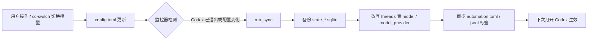

# 架构说明

## 模块划分

```text
codex_model_sync_app.py
├── 核心逻辑层（函数，无界面依赖）
│   ├── find_codex_processes*    进程检测（ctypes 枚举，tasklist 兜底）
│   ├── read_config_defaults     读取 ~/.codex/config.toml 的 model / model_provider
│   ├── find_state_db            定位 state_*.sqlite（含 threads 表）
│   ├── run_sync                 同步主流程：备份 → 改写 threads → 定时任务 → jsonl
│   └── backup_files / sync_jsonl_model_provider / automation_* 等辅助逻辑
├── GUI 层（tkinter）
│   ├── 配置展示与编辑
│   ├── 预览 / 执行 / 打开备份目录
│   └── 日志与状态栏
├── 托盘层（pystray）
│   ├── 最小化到后台
│   └── 托盘菜单：显示主界面 / 立即同步 / 自动同步监控 / 退出
└── 自动监控层
    ├── 定时轮询（约 2s）检测 Codex 进程与配置指纹
    └── 触发条件：Codex 退出，或配置模型/供应商变化
```

## 数据流



## 安全设计

1. **写库前进程检查**：Codex 运行中禁止写入，防止数据库损坏或改动被覆盖
2. **自动备份**：每次写库前将 `state_*.sqlite`（含 WAL/SHM）复制到 `~/.codex/backups/`
3. **预览模式**：dry-run 只读，不产生任何写入
4. **单实例互斥**：避免多个实例重复同步

